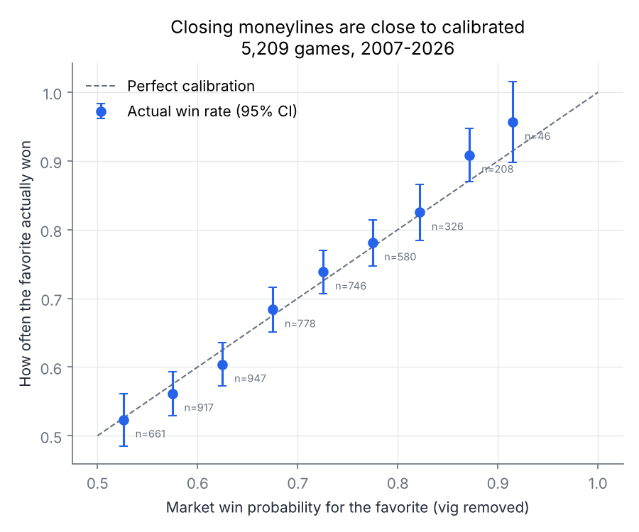
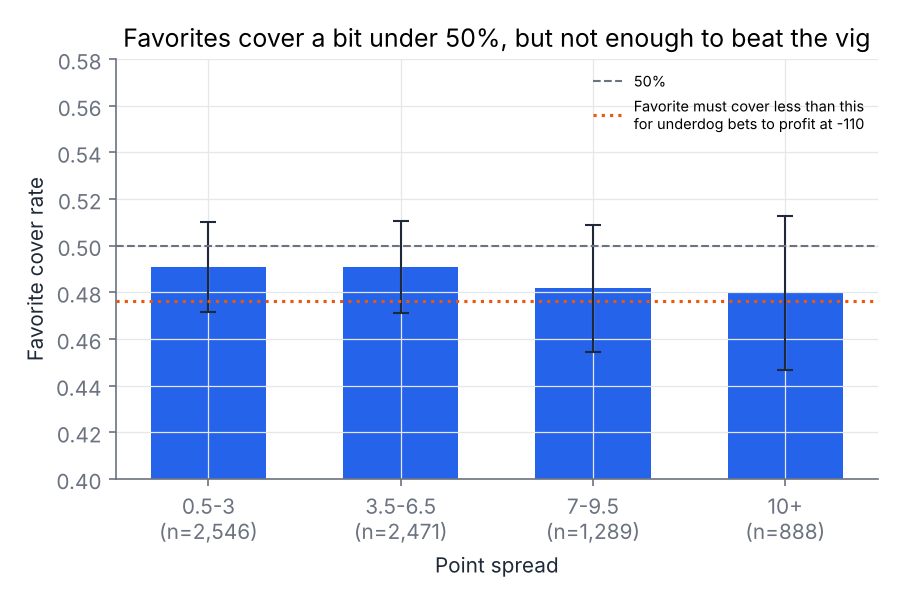
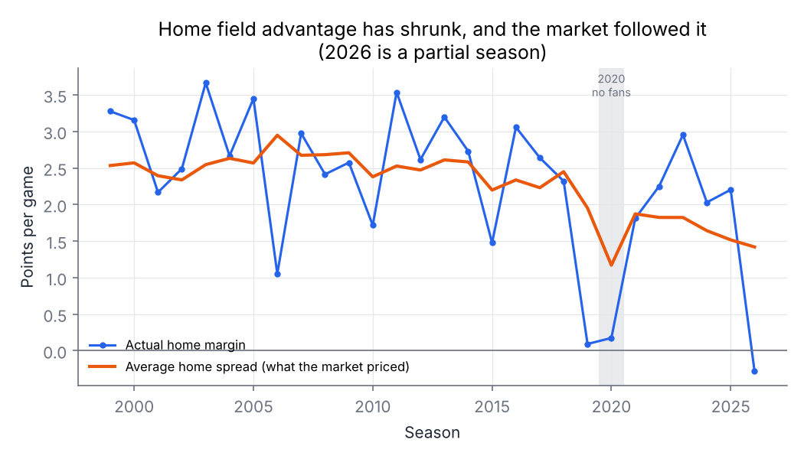
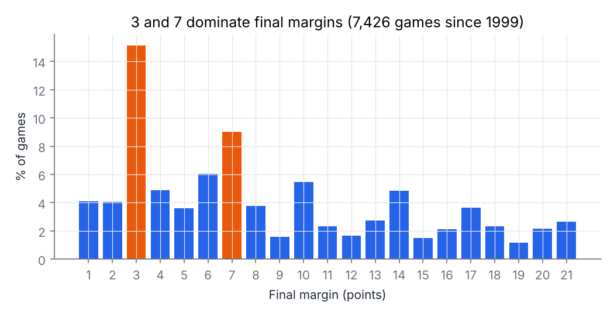

# Is the NFL betting market efficient?

[](https://github.com/vincentweikum/nfl-market-efficiency/actions/workflows/ci.yml)

An analytics engineering and statistics project on **7,426 NFL games (1999 through Week 10 of 2026)** and their closing betting lines. Raw data goes through a tested **dbt + DuckDB** warehouse, and a Python layer runs the statistics: calibration, walk-forward model comparison, hypothesis tests with multiple-testing correction, and a backtest at real closing prices.

**Short answer: yes, mostly.** Closing moneylines are close to calibrated, a public Elo model can't beat them, and no simple spread rule clears the vig. The one consistent pattern (heavy favorites win a bit more than priced) is real in direction but too small to bet on.

## Findings

| Question | Result |
|---|---|
| Are closing moneylines calibrated? | Close. A logistic calibration slope of **1.06** (95% bootstrap CI 0.99 to 1.14), where 1.0 is perfect, over 5,209 games since 2007. |
| Favorite-longshot bias? | Heavy favorites (85%+) were priced at **88.0%** and won **91.7%** of 254 games. Betting all of them at the actual closing price returned **+1.3% ROI, standard error 1.9%**: not distinguishable from zero. |
| Can a public model beat the market? | No. A walk-forward Elo built from scores scored a Brier of **0.220** vs the market's **0.211** (lower is better) and picked winners 64.8% vs 66.7%. Adding Elo to the market on held-out 2019 to 2026 games made predictions slightly **worse** (0.2110 vs 0.2107). |
| Do favorites or underdogs cover? | Favorites covered **48.8%** of 7,194 decided games. Underdogs in the best bucket (10+ points) covered 52.0%, short of the **52.4%** needed to profit at -110. No bucket is significant, before or after Bonferroni correction. |
| Has home field advantage changed? | It shrank from **2.7 points** a game (1999 to 2009) to **1.9** (2015 to 2025), and the average home spread moved almost exactly with it (2.6 to 1.9). |
| Anything weird in 2026? | Through Week 10, home teams covered only **42.3%** (58 of 137 decided games). That's a two-sided p of 0.09: worth watching, not yet a signal. |
| Key numbers | **15.1%** of games end with a 3-point margin and **9.0%** with 7, versus about 4 to 5% for 2 or 4. This is why half a point around 3 and 7 is worth so much. |

Every number above is written to [`reports/findings.json`](reports/findings.json) by the code, so the write-up can be checked against it.

| | |
|---|---|
|  |  |
|  |  |

## How it works

```
nflverse games.csv
      │
      ▼
dbt (DuckDB)
  staging/stg_games            typed, renamed, completed games only
  intermediate/int_game_markets   no-vig probabilities, ATS and totals outcomes, price quality flag
  marts/fct_games, mart_*      game fact table + calibration, ATS, home edge, margin marts
  19 data tests                unique keys, accepted values, scores match margins, sane prices
      │
      ▼
analysis/run_analysis.py       stats, charts, findings.json
```

**A data quality catch.** The first `dbt build` failed a custom test: one 2020 game had home and away moneylines that implied a *negative* bookmaker margin, which can't happen with a real two-sided price (the two sides were pulled from different books). The model now flags any game whose hold isn't between 0 and 15% and leaves it out of the probability analysis. That removed 90 of 5,314 games since 2007.

**Methods notes**

- Vig is removed proportionally: each side's implied probability is divided by their sum.
- The Elo model only sees games played before the one it's predicting (unit tested), uses a margin-of-victory multiplier, reverts a third toward the mean between seasons, and keeps one history for relocated franchises (OAK/LV, SD/LAC, STL/LA).
- The blend test trains on 2009 to 2018 and scores on 2019 onward, so it can't fit to the games it's graded on.
- Spread tests are one-sided binomial tests against the -110 breakeven (110/210), with Bonferroni correction across the four buckets.

## Run it

```bash
pip install -r requirements.txt
make all        # dbt build + tests, analysis, pytest
make data       # optional: pull the latest games from nflverse first
```

The repo ships a snapshot of the games file so it runs offline. CI runs the full pipeline on every push and refreshes the data every Tuesday after Monday Night Football.

## Data

Game results and closing lines from [nflverse](https://github.com/nflverse/nfldata) (`games.csv`). Moneylines are complete from 2007 on, so probability analysis starts there; spread and totals go back to 1999.

## Stack

Python, SQL, dbt, DuckDB, pandas, scikit-learn, SciPy, matplotlib, pytest, GitHub Actions
